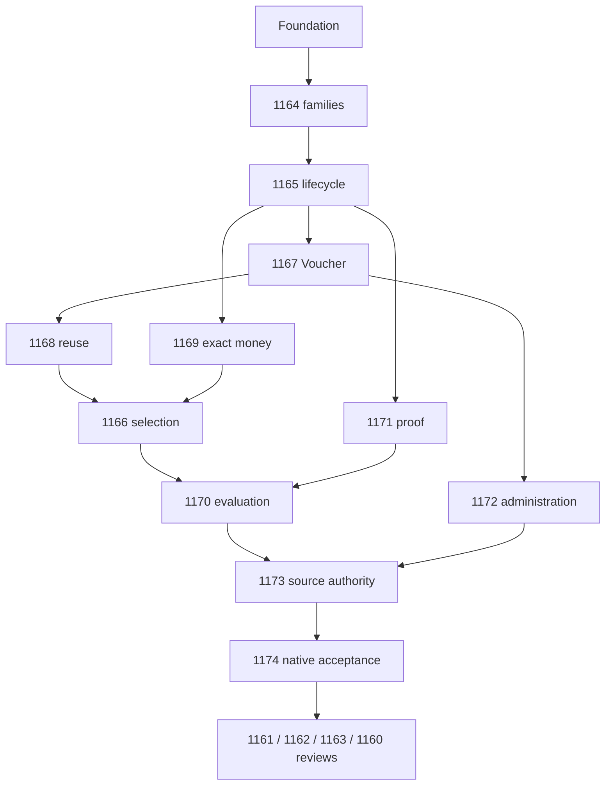

# c18-99-rollup

## Final accepted checkpoint, 2026-11-09

The complete requested owner scope and all required reviews are accepted. The tracked specification `specs/feature-c18-promotion-owner.md` records exact commands, revisions, preserved failures and the qualified nineteen-unit result: eighteen immutable artifacts at `ec9d6e107` and repaired Projects at `728c51829`, each with its own actual identity and source closure. This is not a uniform-SHA aggregate pass. All six previously pending acceptance/rollup outcomes are now complete; all 64 plan todos are completed. Pricing/GROSS/Commerce/Delivery adoption and production activation remain separate gates. Earlier checkpoints below are historical.

## Execution Notes

This is the entrypoint and final rollup for the C18 plan set. The user subsequently invoked `$ontos-implement-spec` and authorized execution on the new isolated sandbox branch. Implementation, required owner acceptance and independent reviews are complete. All 64 todos are completed. Exact validation revisions and the qualified per-unit artifact mapping are recorded in `specs/feature-c18-promotion-owner.md`. Plans live in application-local `.codex/plans/` because application work belongs under `app/`.

## Complete issue coverage

The GitHub sub-issue tree was enumerated recursively on 2026-11-06. Each issue below has an implementation or rollup outcome and an explicit review todo. All were open with `specified` and exactly `status:now`; labels must be reread at execution time.

| Issue                                                   | Delivery plan                                     | Reviewed outcome                                                                     |
| ------------------------------------------------------- | ------------------------------------------------- | ------------------------------------------------------------------------------------ |
| [#1160](https://github.com/TechsioCZ/ontos/issues/1160) | this plan                                         | All root invariants, BDD and descendants                                             |
| [#1161](https://github.com/TechsioCZ/ontos/issues/1161) | this plan                                         | Model/rules branch after its children                                                |
| [#1162](https://github.com/TechsioCZ/ontos/issues/1162) | this plan                                         | Voucher/monetary branch after its children                                           |
| [#1163](https://github.com/TechsioCZ/ontos/issues/1163) | this plan                                         | Owner-contracts/operations branch after its children                                 |
| [#1164](https://github.com/TechsioCZ/ontos/issues/1164) | [families](c18-1164-families.plan.md)             | Five supported activation/target/effect families                                     |
| [#1165](https://github.com/TechsioCZ/ontos/issues/1165) | [lifecycle](c18-1165-lifecycle.plan.md)           | Draft, immutable offer, successor, history                                           |
| [#1166](https://github.com/TechsioCZ/ontos/issues/1166) | [selection](c18-1166-selection.plan.md)           | Cardinality, combinations, two independent rankings                                  |
| [#1167](https://github.com/TechsioCZ/ontos/issues/1167) | [Voucher](c18-1167-voucher.plan.md)               | Identity/code/binding and explicit product choice                                    |
| [#1168](https://github.com/TechsioCZ/ontos/issues/1168) | [reuse](c18-1168-reuse.plan.md)                   | Repeated B2C use without consumption                                                 |
| [#1169](https://github.com/TechsioCZ/ontos/issues/1169) | [money](c18-1169-money.plan.md)                   | Purchase basis, cap and exact allocation                                             |
| [#1170](https://github.com/TechsioCZ/ontos/issues/1170) | [evaluation](c18-1170-evaluation.plan.md)         | Real staged evaluator and typed outcomes                                             |
| [#1171](https://github.com/TechsioCZ/ontos/issues/1171) | [proof](c18-1171-proof.plan.md)                   | Attributable set, staged completeness/currentness; final issue review in #1174       |
| [#1172](https://github.com/TechsioCZ/ontos/issues/1172) | [administration](c18-1172-administration.plan.md) | All management intents, audit, permissions, concurrency; final issue review in #1174 |
| [#1173](https://github.com/TechsioCZ/ontos/issues/1173) | [authority](c18-1173-authority.plan.md)           | OntOS writer, own retained history, no legacy importer                               |
| [#1174](https://github.com/TechsioCZ/ontos/issues/1174) | [acceptance](c18-1174-acceptance.plan.md)         | Native integrated owner acceptance and handoff                                       |

[Foundation](c18-00-foundation.plan.md) records current code evidence, global rules, generators, known environment limits and shared-file ownership. Every lane must read it before editing. The issue's complete live body is acceptance authority; plan summaries do not replace criteria or silently weaken them.

## Execution waves and review

1. Coordinator prepares the sandbox and generated owner, then completes family and lifecycle contracts. Nothing starts against unstable shared contracts.
2. Use implementation subagents for Voucher, exact money and proof in parallel. At most three child agents run beside the coordinator. When Voucher is reviewed, a slot can move to administration while reuse tests proceed without conflicting file edits. Swap slots for independent review as required.
3. Selection joins reviewed reuse and money. Evaluation joins selection and proof-component readiness. Administration can proceed against the agreed evaluator port; acceptance later verifies its real preview wiring.
4. Source-authority acceptance joins real evaluator and management components. Integrated #1174 completes actual preview wiring, then performs the final independent #1171 and #1172 issue reviews against real services, followed by the remaining integrated tests and #1174 review. The final rollup reviews #1161, #1162, #1163 and #1160 separately.

Proof and administration component-readiness checks are not final issue reviews or permission to close #1171/#1172. Their explicit final reviews in #1174 remove a dependency cycle while preserving early parallel work.

For each issue, its implementing agent adds behavior/tests and runs focused validation. A different review agent reads the complete issue, relevant parent/root rules and actual diff/test results, checks the applicable project guidance, and reports concrete findings. The implementation owner repairs in-scope findings, reruns tests and obtains re-review. Preserve one coverage record per issue with criterion/BDD, code/test references, executed command/result, reviewed revision and unresolved limitations. Do not substitute inherited child completion for a parent's own review.

Coordinator exclusively integrates generator patches, migrations, package exports, workspace/lockfile, topology/manifests/registration and shared fixtures. Assign workers non-overlapping generated services/tests and approved schema files. Use `subagent-graph` only after graph validation and explicit execution authorization. No agents were launched during the original planning phase. Execution subsequently used the three explicitly authorized subagent lanes; their independent review reports are under `.codex/reports/`.

## Constraints

[#253](https://github.com/TechsioCZ/ontos/issues/253) is READONLY, including comments and sub-issue relationships. Closed issues are read-only. Do not create downstream issues or edit status labels, and do not implement roadmap siblings as hidden dependencies. Follow all foundation constraints.

Explicit exclusions: #894 Pricing adoption, #895/#896 Storefront, #898 Cart, #899 Order, #900 Limits/Approval, #901 Checkout, #902 and #329-#331 commitment/recovery, #904 production acceptance, #891 currencies, Delivery/Shipping step 30 and shipment work 36-38, Billing and migration. #892 Pricing/TAX was documented `status:now`, not PARK; it is still outside this requested subtree. #869 must not be planned or implemented. No published GROSS producer or consumer transport is included here.

Do not auto-close issues, post review comments or publish roadmap updates as a side effect of local completion. Report locally unless the user explicitly authorizes hosting mutations. Do not claim all work complete if any criterion, review or required test remains unresolved.

## Operator Guidance

This node depends on reviewed #1174 and is a downstream rollup, not an independent launch lane. Run the exact graph selection/edges below from `app/` with the installed plan-graph CLI. Reuse these edges for validation, DAG inspection, frontier and later orchestration; body prose alone does not enforce dependencies.

The graph can be regenerated without creating any implementation agent. The full-gate evidence from #1174 remains required; review-driven code changes trigger the appropriate tests and full required checks again. Planning validation proves graph integrity only, not application behavior.

A new branch `plan/c18-promotion-1160` was created for this task. Execution must continue on a feature branch in the required isolated sandbox, preserving pre-existing local work and the reviewed plan bundle. No business decision is reopened: precision variant A, product-before-cart, all four pairings, free-shipping activation/ranking, basis and no-migration are accepted. Known execution prerequisites are a trusted installed mise toolchain, verified pinned generator coverage, a prepared database sandbox and current auth/source status. Missing external published GROSS or Delivery evidence is an expected typed safe outcome, not a reason to implement downstream scope.

## Graph handoff

Validated on 2026-11-06 with no parser or graph warnings. Thirteen plans, fifteen inter-plan edges, sixty-four pending todos. The only initial ready lane is foundation. Do not interpret graph readiness as execution authorization.

Run from `app/`:

```sh
python3 /home/tsnheathen/.codex/skills/plan-graph/scripts/plan_graph.py validate \
  --plans-root .codex/plans --glob 'c18-*.plan.md' --strict \
  --graph-id c18-promotion-1160 \
  --depends c18-00-foundation:c18-1164-families \
  --depends c18-1164-families:c18-1165-lifecycle \
  --depends c18-1165-lifecycle:c18-1167-voucher \
  --depends c18-1167-voucher:c18-1168-reuse \
  --depends c18-1165-lifecycle:c18-1169-money \
  --depends c18-1165-lifecycle:c18-1171-proof \
  --depends c18-1167-voucher:c18-1172-administration \
  --depends c18-1168-reuse:c18-1166-selection \
  --depends c18-1169-money:c18-1166-selection \
  --depends c18-1166-selection:c18-1170-evaluation \
  --depends c18-1171-proof:c18-1170-evaluation \
  --depends c18-1170-evaluation:c18-1173-authority \
  --depends c18-1172-administration:c18-1173-authority \
  --depends c18-1173-authority:c18-1174-acceptance \
  --depends c18-1174-acceptance:c18-99-rollup
```

For `dag`, `frontier` or `summary`, replace `validate` and keep the same selection and edges. Add `--format mermaid` for a visual DAG or `--format json` for machine-readable handoff. Use `--write-state` when persisting the explicit graph slot. The current handoff is:

- graph_id: `c18-promotion-1160`
- selection_hash: `74640b0430`
- selected paths: the thirteen `app/.codex/plans/c18-*.plan.md` files in this bundle
- snapshot_path: `/home/tsnheathen/.local/share/locki/worktrees/ontos-locki-f6l7qvev/app/.codex/plan-graphs/c18-promotion-1160/snapshot.json`
- state_dir: `/home/tsnheathen/.local/share/locki/worktrees/ontos-locki-f6l7qvev/app/.codex/plan-graphs/c18-promotion-1160`

Selection hashes contain resolved paths. Regenerate the snapshot after carrying the plan set into a different sandbox, retaining the same graph selection and edges. Do not reuse this checkout's absolute paths as sandbox paths.



## Earlier owner handoff, superseded by fresh review, 2026-11-07

All required owner tests, complete repository and tooling gates, database/trust checks and the standard parallel full build passed. The build validated implementation commit `f679e3789d735844baca6a246591294de4b36eb6`; all source manifests match before/after build and compiled runtime smoke. Actual built Promotion readiness returned HTTP 200 with that exact revision and consistent marker in the canonical build namespace. Final independent issue/parent/root reviews accepted the complete requested owner scope; see `.codex/reports/c18-final-parent-review.md`, `.codex/reports/c18-final-foundation-acceptance-review.md` and `.codex/reports/c18-final-validation-review.md`. No downstream adoption, production activation, roadmap mutation or issue closure was performed. Remaining changes after validated executable source are completion/evidence documentation only.

## Earlier review checkpoint, 2026-11-07

The prior accepted handoff is historical and superseded. The repaired source and Promotion glibc Linux plus Alpine/musl materialized-runtime profiles passed at `e5cc327ad`; this proves Promotion owner-local portability, not the complete required all-Node artifact matrix. Cart/Order executed build-host anchors remain a baseline artifact obstacle outside this C18 repair. The gate is not waived and no requirement or scope changed.

Final frozen validation of clean implementation revision `1b6ee79c18ba8da49588ca09d3598fd087b24857` passed all 24 recorded commands, including complete tooling, owner/native and Pricing/Core regressions, authorization/database/trust checks, full `pnpm check --concurrency 2`, complete `pnpm build`, and final isolated materialized Promotion readiness/public-contract proof. All 14,578 source entries match and command/source exits are zero. Later changes only correct status/evidence documentation; the runtime proof retains its actual implementation SHA. All six remaining acceptance/rollup todos stay pending, including executed source reviews whose final acceptance depends on unfinished predecessors. The current graph remains 58 completed of 64, with no all-64-complete claim. See `.codex/reports/c18-fresh-implementation-review.md` and `.codex/reports/c18-final-scope-consistency-review.md`.

## Continuation checkpoint, 2026-11-07

This checkpoint supersedes the earlier Cart/Order-anchor and completion assessments. The retained implementation checkpoint `bb85c1d73` has the same Git tree as `1f6fdd6c0`: it includes the reviewed public-SDK final Node normalization/resealing repair, with 48 focused controls and complete tooling passing at 1f6. Earlier f05 standard build/full check, 96 Promotion units, 14 native owner cases and corrected environment-specific native proofs remain attributed to their actual revisions.

Final acceptance is blocked by actual Party SSR in the pinned native i18n/compiler/Module Federation cohort. Two real Alpine build pairs passed; their direct SSR probes still returned client fallback with `TypeError: n is not a function`. The second output retained all six requested eager flags, but the generated integration still synchronously consumes an async provider. Full unchanged-source closure passed. Unsuccessful application-sharing experiments were reverted; no dependency patch, SSR/sharing bypass or acceptance exception is retained.

The required complete artifact matrix is not established. The 1f6 aggregate check also remains explicitly failed because it ran against stale compiled contracts before a new build; all its other steps passed. No historical result is relabelled as a current full-gate success. The next prerequisite is a tested compatible framework/cohort correction, followed by the unchanged final build/runtime/repository checks.

All fifteen live issue bodies still match the reviewed criteria and retain exactly `status:now`. Status remains `in_progress`, with 58 of 64 todos complete and the same six pending acceptance/rollup tasks. Scope and downstream exclusions are unchanged. Exact results, revisions, failed attempts, reviewer provenance and the remaining boundary are in `.codex/reports/c18-bounded-ssr-verdict.md` and `.codex/reports/c18-party-ssr-runtime-probe-review.md`.

## Framework repair checkpoint, 2026-11-08

OntOS commit `1fced8d73` aligns the exact declared Rsbuild 2.2.13 / Rspack 2.2.9 cohort; the aligned original SSR probe still failed. Framework branch `codex/ontos-native-i18n-ssr`, commit `0889ac34174f996973405d64c662b5559dbbc1f0`, fixes the native factory's eager backend dependency with one direct instance-module import. Its compiler regression failed before the repair and passes afterwards; all 67 native i18n tests, all 51 framework build tasks, canonical fork-boundary checks and normal commit hooks passed.

The normal release preparer produced all 49 local `.19` cohort packages. An isolated Alpine OntOS copy installed them normally, rebuilt Privacy and Party, and passed the original SSR request without fallback. The unchanged materializer then passed through the framework's official exact-artifact local registry and source-qualification policy. The complete focused Party artifact proof passed with source trees hidden, network disabled, public SDK envelopes verified, genuine SSR, emitted assets and executed MF exports. The first runtime attempt exposed a harness mistake: the published Node ABI selects the manifest-declared named container. Correcting that consumer and awaiting exposed factories passed 29 controls and the runtime proof against identical artifact bytes.

This is focused local-candidate evidence, not the full nineteen-unit matrix or a final published-dependency gate. The application baseline remains `1fced8d73`; only the isolated copy's dependency declarations and pnpm-generated lockfile differ. All 11,387 checked non-runtime source files otherwise match. The framework candidate source is recorded separately as 0889; no artifact identity was relabelled.

The next external prerequisite is submission and publication of the reviewed framework repair through its trusted workflow. After an approved full-cohort release, update OntOS normally and run the unchanged complete artifact and repository gates on the final dependency state. No remote publication, push, issue mutation or downstream adoption occurred. Status remains `in_progress`, with the same 58 completed and six pending graph todos. Details and failed attempts: `.codex/reports/c18-upstream-native-i18n-fix-0889.md`.
