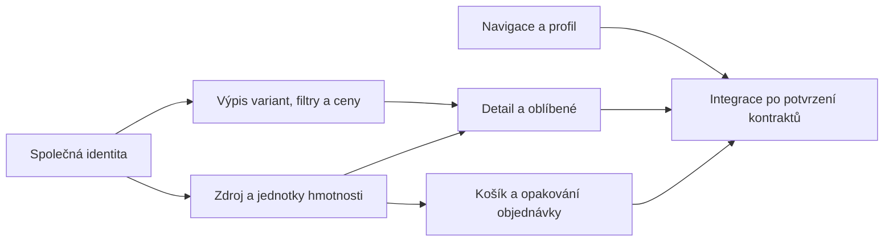

# Demo e-shop: další implementační plán

Stav: postupné upřesňování a realizace po jednotlivých úkolech. Aktuální stav
implementace je ve frontmatteru odkazovaných plánů. Výchozí větev je `feat/akros`, revize
`0bf9acc9`; předchozí šestibodový refaktor UI kitu je dokončený.

## Dohodnutý postup po jednotlivých úkolech

Po upřesnění uživatele se rozbor vede v původním pořadí **TASK 01 → 17**. Níže
navržené technické návaznosti slouží jako podklad, nikoli pokyn začít implementaci
jiného úkolu nebo přidružený refaktor bez rozboru daného zadání.

U každého úkolu nejprve porovnat aktuální lokální stav, chování
[nasazeného dema](https://akros-pi.vercel.app/) a příslušný návrh. Issue může popisovat
chybu staršího deploye, která už je lokálně opravená. Rozlišit hotové chování,
potvrzené mezery a nejasnosti; navrhnout konkrétní zbývající změnu a její ověření.
Teprve po společném ujasnění zadání přejít k implementaci daného úkolu.

[TASK 01](plans/akros-task-01-review.md) je lokálně implementovaný a ověřený.
[Rozbor TASK 02](plans/akros-task-02-review.md) navrhuje dialog pro výběr oblíbených
variant, vhodné komponenty kitu a návaznost na stránku oblíbených. Zahrnuje také nové
upřesnění z 21. 10. 2026: přejmenování „Poslat kamarádovi“ na „Sdílet“ a přidání tisku.
Po souhlasu s realizací používáme „Uložit výběr“ a produktový list bez seznamu variant.
TASK 02 a doplňkové akce jsou lokálně implementované a ověřené; podrobnosti vlastní
odkazovaný rozbor. Následné upřesnění rozšiřuje stejný výběr na hlídání, dotaz a sdílení
více variant; [záznam úpravy](plans/akros-task-03-actions-review.md) popisuje také přesné
odkazy a sjednocení stínu. Základ stránky oblíbených pokrývá část TASK 13;
navazující modal z TASK 03/07 a jeho ověření vlastní níže uvedený rozbor.
GitHub issues zůstávají beze změny.

Uživatel odsouhlasil [detailní návrh TASK 03 + 07](plans/akros-task-03-07-review.md)
a jeho realizaci: modal z názvu varianty, přímé akce, obrázkový náhled a přesná URL.
Jednotka kg byla 22. 10. 2026 doložena podle stejných SKU na původním e-shopu.
TASK 07 nyní zobrazuje vlastní hmotnost varianty; neznámá zůstává neuvedená.
Přepočet podle kusu/metru/balení pro TASK 16 dále řeší hmotnostní plán.

[TASK 04](plans/akros-task-04-review.md) je implementovaný a ověřený: výpis obsahuje
všechny odpovídající varianty bez opakování kontejneru a bez stránkování. Ověřeno
i na 386 variantách a mobilních šířkách.
[TASK 05](plans/akros-task-05-review.md) přidává bezpečně rozpoznané rozměry a živou
filtraci s resetem, odstraňuje cenu a materiál. Ověřeno včetně 386 variant a obou
desetinných oddělovačů.
[TASK 06](plans/akros-task-06-review.md) je dokončený: nevybrané skupiny mají `Cena dle
varianty`, konkrétní položky skutečnou cenu a cenové prefixy `Od` jsou odstraněné.
Ověřeny cenové plochy, našeptávač i košík na desktopu a mobilu.
[TASK 08](plans/akros-task-08-review.md) je dokončený: celý popis je pod horním
přehledem před variantami, doprava pod akcemi. Opravené zpracování popisu zachovává
důležité materiálové informace, stránka/modal/tisk používají stejný postup.
Ověřeno na desktopu, tabletu, mobilu a hranicích breakpointu, včetně hmotnosti z TASK 07.
[TASK 09](plans/akros-task-09-review.md) je dokončený: horní lišta a mobilní informace
obsahují jen šest schválených textových odkazů. Úvod je dostupný přes logo,
přihlášení samostatně a katalog přes boční/mobilní navigaci. Ověřeno na 12 šířkách,
včetně klávesnice, aktivních odkazů a zavírání menu.
[TASK 10](plans/akros-task-10-review.md) je dokončený: nadpisy, popisy a názvy
podkategorií jsou vycentrované. Ověřeno na pěti kategoriích a 12 šířkách, včetně
dlouhých názvů a chybějícího popisu; změna nezasahuje vyhledávání ani boční katalog.
[TASK 11](plans/akros-task-11-review.md) potvrdil existující vlastní našeptávač.
Opravené odkazy používají pro jednoznačnou variantu její ID; sdílené SKU nevybírá
automaticky první variantu a cenu. Ověřeny návrhy i úplné výsledky na desktopu a mobilu.
Původní lokální rozsah je dokončený; případná Meilisearch integrace zůstává samostatné D7.
Další v původním pořadí je TASK 12 – „Objednat znovu“.

## Zadání a porovnání s GitHubem

Zdroje: zadání uživatele v této konverzaci a issues přiřazené do
[GitHub projektu 4](https://github.com/orgs/TechsioCZ/projects/4), načtené 20. 10. 2026.
Vložený seznam byl dvakrát stejný; plán obsahuje **17 jedinečných úkolů**.

- U 16 issues se všechny body zadání shodují s vloženým seznamem.
- [TASK 07 / #1305](https://github.com/TechsioCZ/ontos/issues/1305) má navíc požadavek:
  při najetí na variantu zobrazit obrázek konkrétní varianty. Je zahrnut do plánu.
- U [TASK 11 / #1309](https://github.com/TechsioCZ/ontos/issues/1309) je
  [komentář z 19. 10. 2026](https://github.com/TechsioCZ/ontos/issues/1309#issuecomment-6266134947),
  který navrhuje řešit našeptávač později implementací Meilisearch. Jde o návrh pořadí
  a technologie; nenahrazuje původní zadání ani schválení konkrétní integrace.
- Všech 17 issues je otevřených, má label `bug` a zatím nemá label `status:*`.
  Starý uzavřený test #1073 není součástí implementace. Issues ani projekt nebyly změněny.

Issues byly ověřeny přes GitHub issue search s kvalifikátorem
`org:TechsioCZ project:TechsioCZ/4`, následně byla přečtena jejich celá zadání a komentáře.
Přímé Projects API vyžaduje chybějící OAuth scope `read:project`; projektové pohledy,
vlastní pole, draft karty a jejich pořadí proto nejsou ověřené. Toto omezení se netýká
porovnání výše uvedených 17 konkrétních issues.

## Přehled úkolů

Stavy a podrobná kritéria dokončení jsou v odkazovaných plánech.
Čísla TASK zachovávají původní zadání, pořadí implementace se řídí návaznostmi níže.

| TASK | GitHub                                                  | Požadovaný výsledek                                                 | Implementační část                                          |
| ---- | ------------------------------------------------------- | ------------------------------------------------------------------- | ----------------------------------------------------------- |
| 01   | [#1298](https://github.com/TechsioCZ/ontos/issues/1298) | Varianty podle Figmy, menší nákupní tlačítko a čitelný kód          | [Výpis variant](plans/akros-variants.plan.md)               |
| 02   | [#1300](https://github.com/TechsioCZ/ontos/issues/1300) | Oblíbené ukládají konkrétní variantu a zobrazují její stav          | [Detail a oblíbené](plans/akros-detail.plan.md)             |
| 03   | [#1301](https://github.com/TechsioCZ/ontos/issues/1301) | Hlídání, dotaz a sdílení patří konkrétní variantě                   | [Detail a oblíbené](plans/akros-detail.plan.md)             |
| 04   | [#1302](https://github.com/TechsioCZ/ontos/issues/1302) | Výpis bez opakování kontejneru, přednostně všechny varianty         | [Výpis variant](plans/akros-variants.plan.md)               |
| 05   | [#1303](https://github.com/TechsioCZ/ontos/issues/1303) | Relevantní parametry, bez ceny a materiálu, prověřená živá filtrace | [Výpis variant](plans/akros-variants.plan.md)               |
| 06   | [#1304](https://github.com/TechsioCZ/ontos/issues/1304) | Žádné ceny „Od“, skutečná cena až u prodejné položky                | [Výpis variant](plans/akros-variants.plan.md)               |
| 07   | [#1305](https://github.com/TechsioCZ/ontos/issues/1305) | Modální detail, váha varianty, popis, akce a náhled obrázku         | [Detail a oblíbené](plans/akros-detail.plan.md)             |
| 08   | [#1306](https://github.com/TechsioCZ/ontos/issues/1306) | Přehledné rozmístění popisu a informací o dopravě                   | [Detail a oblíbené](plans/akros-detail.plan.md)             |
| 09   | [#1307](https://github.com/TechsioCZ/ontos/issues/1307) | Horní seznam odkazů obsahuje jen textové stránky                    | [Navigace a profil](plans/akros-account-navigation.plan.md) |
| 10   | [#1308](https://github.com/TechsioCZ/ontos/issues/1308) | Vycentrované názvy a doprovodné texty kategorií                     | [Navigace a profil](plans/akros-account-navigation.plan.md) |
| 11   | [#1309](https://github.com/TechsioCZ/ontos/issues/1309) | Našeptávač se správným směrováním na produkt a variantu             | [Navazující integrace](plans/akros-integrations.plan.md)    |
| 12   | [#1310](https://github.com/TechsioCZ/ontos/issues/1310) | Opakované objednání do aktuálního košíku s aktuální dostupností     | [Košík a objednávky](plans/akros-cart.plan.md)              |
| 13   | [#1311](https://github.com/TechsioCZ/ontos/issues/1311) | Skutečný seznam oblíbených variant, výběr přes odkaz a odebrání     | [Detail a oblíbené](plans/akros-detail.plan.md)             |
| 14   | [#1312](https://github.com/TechsioCZ/ontos/issues/1312) | Funkční editace profilu a dohodnutá správa uložených adres          | [Navigace a profil](plans/akros-account-navigation.plan.md) |
| 15   | [#1313](https://github.com/TechsioCZ/ontos/issues/1313) | Skutečná změna hesla v osobních údajích po napojení na autentizaci  | [Navazující integrace](plans/akros-integrations.plan.md)    |
| 16   | [#1314](https://github.com/TechsioCZ/ontos/issues/1314) | Celková hmotnost košíku z variant a skutečných množství             | [Košík a objednávky](plans/akros-cart.plan.md)              |
| 17   | [#1315](https://github.com/TechsioCZ/ontos/issues/1315) | Adresní našeptávání přes vybraný a ověřený zdroj                    | [Navazující integrace](plans/akros-integrations.plan.md)    |

## Co už v aplikaci existuje

Ověřeno ve zdrojích výchozí revize; nejde o prohlášení, že související issue je hotové.

| Oblast              | Současný stav a důsledek pro implementaci                                                                                                                                                                  |
| ------------------- | ---------------------------------------------------------------------------------------------------------------------------------------------------------------------------------------------------------- |
| Identita nákupu     | `src/mock-storefront/cart.ts` už rozlišuje `productId` a `variantId`. Navázat na tento model, nevytvářet oddělenou identitu pro každou funkci.                                                             |
| Výpis variant       | `product-purchase-form.tsx` stránkuje po pěti, opakuje název kontejneru a aplikuje cenu, materiál a rozměry až po potvrzení. Změna vyžaduje upravit i dosavadní testy těchto pravidel.                     |
| Detail varianty     | `?variant=` nyní slouží jako hledaný výraz pro filtr. V prohlédnutém detailu není variantní Dialog. Požadované modální chování bude nutné doplnit, nikoli pouze přestylovat.                               |
| Tlačítko z TASK 01  | Ve zdroji je „Koupit celé balení“, zatímco zadání říká „Celé zboží“. Před změnou ověřit ve Figmě, zda jde o stejný prvek; nepřejmenovávat automaticky.                                                     |
| Oblíbené            | Srdíčka vedou na `/oblibene`, stránka zobrazuje šest ukázkových produktů. Chybí skutečný seznam a stav konkrétních variant.                                                                                |
| Další akce          | Hlídání ukládá klíč podle `productId`, dotaz míří na obecný kontaktní formulář a sdílení používá aktuální URL. Je potřeba jednotný kontext varianty a obnova stavu.                                        |
| Hmotnost            | `net_weight` se načítá z feedu, ale `netWeight` se generuje pouze na kontejner. `CatalogProductVariant` ani řádek košíku hmotnost nemají. Váhu kontejneru nelze automaticky použít pro všechny varianty.   |
| Našeptávač          | `HeaderSearch` už používá vlastní vyhledání v lokálním katalogu a kit `SearchSuggestions`, včetně kategorií a variantních URL. Rozšířit nebo nahradit dohodnutou část, nestavět souběžný druhý našeptávač. |
| Profil a adresy     | Profil se už validuje a ukládá lokálně, existují fakturační a dodací pole. Chybí potvrzení cílového rozsahu adresáře a případné serverové persistence.                                                     |
| Heslo               | Přihlášení je demo přesměrování. Změna hesla v profilu výslovně není napojená na účet. Lokální potvrzovací hláška nemůže splnit TASK 15.                                                                   |
| Historie objednávek | Historie a detail používají ukázková data bez spolehlivých vazeb řádků na katalog. Vedle toho existuje poslední lokálně dokončená objednávka. Pro opakování je nutný jednotný a konkrétní zdroj řádků.     |

## Doporučené pořadí a návaznosti

1. [Společný základ](plans/akros-foundation.plan.md): identita prodejné položky a
   přesný odkaz na variantu. Technický předpoklad původních úkolů, nikoli nový úkol.
2. [Výpis variant](plans/akros-variants.plan.md): 04 → 05 → 01 → 06.
   Úpravy výpisu, filtrů a cen nemusí čekat na ověření hmotností.
3. [Hmotnost variant](plans/akros-weight.plan.md): zdroj a jednotkový význam pro
   detail a košík. Ověřuje se samostatně po vyjasnění identity.
4. [Detail a oblíbené](plans/akros-detail.plan.md): po výpisu a hmotnostech společně
   03 + 07 → 08 → 02 → 13. Modal a jeho akce sdílejí stav i stejné soubory.
5. [Navigace a profil](plans/akros-account-navigation.plan.md): 09 → 10 → 14.
   Tato část nepotřebuje čekat na předělání variant.
6. [Košík a objednávky](plans/akros-cart.plan.md): po ověření hmotností 16 → 12;
   nemusí čekat na všechny vizuální úpravy detailu.
7. [Navazující integrace](plans/akros-integrations.plan.md): 11, 15 a 17 až po
   upřesnění jejich kontraktů. Komentář navrhuje odklad TASK 11; neposouváme kvůli
   němu ostatní frontendové úkoly a neměníme žádný GitHub status.

Hrany pro `plan-graph`: `akros-foundation:akros-variants`,
`akros-foundation:akros-weight`, `akros-variants:akros-detail`,
`akros-weight:akros-detail`, `akros-weight:akros-cart`,
`akros-detail:akros-integrations`, `akros-cart:akros-integrations`,
`akros-account-navigation:akros-integrations`.
Výběr plánů je `--plans-root plans --glob 'akros-*.plan.md'` ze složky storefrontu.
Stavy jednotlivých úkolů vlastní frontmatter těchto souborů; tento přehled se nemá
udržovat jako druhý nezávislý seznam hotových položek.

## Rozhodnutí potřebná před příslušným krokem

| ID  | Co je potřeba určit                                                                                                                                                                                                                  | Které úkoly to podmiňuje                     |
| --- | ------------------------------------------------------------------------------------------------------------------------------------------------------------------------------------------------------------------------------------ | -------------------------------------------- |
| D1  | Pro TASK 01 potvrzeno kompaktní černé „Koupit celé balení“ z rámce `8:1377`, tlačítko `8:1717` (desktop 128 × 38 px). Finální rozložení TASK 07–08 se upřesní samostatně.                                                            | 01 vyjasněné; 07–08 později                  |
| D2  | Pro výběr je zavedeno `variantIds` s přesnými ID; `variant` zůstává volným hledáním. Samostatná položka má referenci `variantId: null` a produktový odkaz. Otevření samotného variantního modalu a jeho historii ještě řeší TASK 07. | 02–03 vyřešené odkazy; návaznost 07, 11–13   |
| D3  | Kg pro zobrazení vlastní hmotnosti varianty doloženo 22. 10. 2026. Pro TASK 16 zbývá ověřit přepočet kus/metr/balení; neúplné či nejednoznačné údaje nenahrazovat odhadem.                                                           | 07 vyřešené zobrazení; 16 přepočet zbývá     |
| D4  | Zda mají být profil a adresy nadále lokální demo, nebo připojené k zákaznickému účtu; zda „uložené adresy“ znamenají dvě současná pole, nebo více adres.                                                                             | 14, návaznost 17                             |
| D5  | Cílová autentizační služba a veřejný kontrakt změny hesla včetně ověření uživatele. Bez něj TASK 15 není implementačně připravený.                                                                                                   | 15                                           |
| D6  | Schváleno: podmínky, o nás, blog, partnerský program, reklamace a kontakty. Domů přes logo, přihlášení samostatně, katalog v bočním/mobilním menu.                                                                                   | 09 vyřešené                                  |
| D7  | Lokální našeptávač z TASK 11 je ověřený. Případná Meilisearch integrace stále potřebuje potvrzený index, veřejné API, aktualizaci dat a způsob nasazení.                                                                             | 11 lokální část hotová; Meilisearch navazuje |
| D8  | Dostupný publikovaný kontrakt vlastní adresní databáze versus FoxEntry; pokrytí, autentizace, data, provoz a chování při nedostupnosti.                                                                                              | 17                                           |

Tyto body jsou cílené vstupní brány pro konkrétní úkoly, nikoli důvod zastavit psaní
plánu nebo nezávislé části. Návrhy v tomto plánu nejsou automaticky schválenými
produktovými rozhodnutími. Před převzetím issue do execution managementu ověřit
aktuální stav a execution label podle `AGENTS.md`; labely neurčuje ani nemění agent.

## Pravidla realizace a společné dokončení

- Měnit pouze `akros-storefront/**`. Neimportovat soukromý kód, databáze či registrace
  z ostatních částí OntOS. Existující adresní službu případně použít přes její schválený
  veřejný kontrakt. Tento plán není povolení zavádět autentizační nebo databázový backend.
- Zachovat práci přes `@techsio/ui-kit`: přednostně props a tokeny; místní CSS pouze
  pro kompozici a ověřené mezery v API. Zachovat dokončený refaktor a jeho omezení.
- Neobnovovat zrušené experimenty s celkovou šířkou storefrontu. Figma úpravy míří na
  dané komponenty, nikoli na nový rozměr celého layoutu bez samostatného zadání.
- Neschovávat nesplněnou serverovou funkci za úspěšnou demo hlášku. Hesla nikdy
  neukládat do browser storage ani logů. Nikdy nečíst `.env`.
- Každý smysluplný celek dodat s funkčními testy a kontrolou desktopu, tabletu a mobilu.
  TASK 03 a 07 lze provést atomicky: modal a jeho akce potřebují tutéž identitu a stav.
- Staré testy měnit podle nových požadavků: například místo ověřování pěti variant
  na stránce ověřit dosažitelnost všech variant; cenový/materiálový filtr nahradit
  ověřením ponechaných parametrů. Neodstraňovat pokrytí jen kvůli zelenému výsledku.
- Při UI změnách kontrolovat 1920, 1440, 1280, 1024, 768, 390 a 320px a obě strany
  dotčených breakpointů. U nové variantní tabulky také šířku jejího kontejneru.
- Před dokončením celku spustit `npm run check` a relevantní browserové sady; před
  uzavřením celé implementace `npm run test:browser` se spuštěným storefrontem.
  Ponechat kontroly minima, celých balení, desetinných množství, skladu a cen s/bez DPH.
- Issues neuzavírat ani nepřepisovat v rámci přípravy tohoto lokálního plánu. Uzavřené
  issues zůstávají pouze pro čtení. Každý commit má uvést konkrétní dokončený celek.
